<p align="center">
  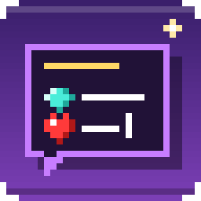
</p>

<h1 align="center">Textboxes</h1>

<p align="center">
  Put your own textboxes anywhere on your Minecraft HUD, with colors, fonts, images and item icons right in the text.<br>
  <b>Fabric · Minecraft 1.21.11 and 26.3 · Client-side</b>
</p>

<p align="center">
  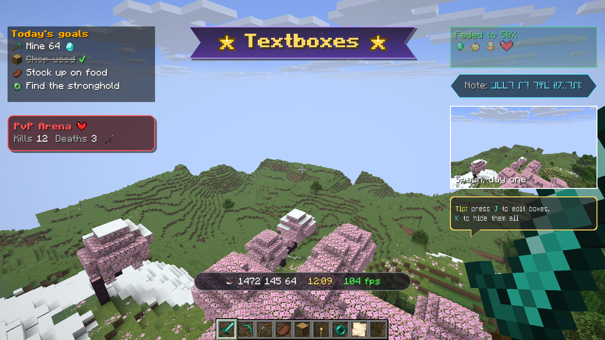
</p>

Write notes, goals, server rules, stats or labels, and style them however you like. Every box has its own colors, opacity, fonts, borders and images, and you can drop any item or picture right into the text.

Everything is edited in-game, and nothing goes in a config file by hand. Press **J**, drag a box where you want it, and start typing.

## ✨ Features

### 📝 Textboxes on your HUD
- Add as many boxes as you want. They stay on screen while you play.
- Multi-line text with word wrap. Minecraft color codes (`§`) work too.
- Press **K** to hide or show every box at once.

### 🖱️ Easy in-game editor
- **Drag** a box to move it, or **drag the corner** to resize it.
- **Double-click** a box to edit its text.
- Add, duplicate, delete, bring forward and send back from the toolbar.
- Use the arrow keys to nudge a box pixel by pixel (hold Shift for 10px).
- The settings panel can sit on the left or right, or be hidden so you can see the whole screen.
- **Undo and redo** with Ctrl+Z and Ctrl+Y.
- Boxes **snap** to screen edges, the center and each other while you drag. You can turn this off.

<p align="center">
  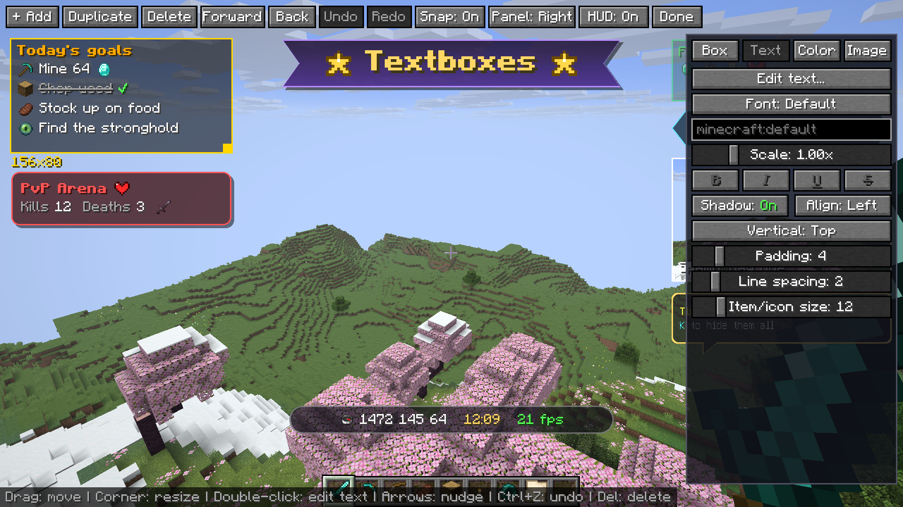
  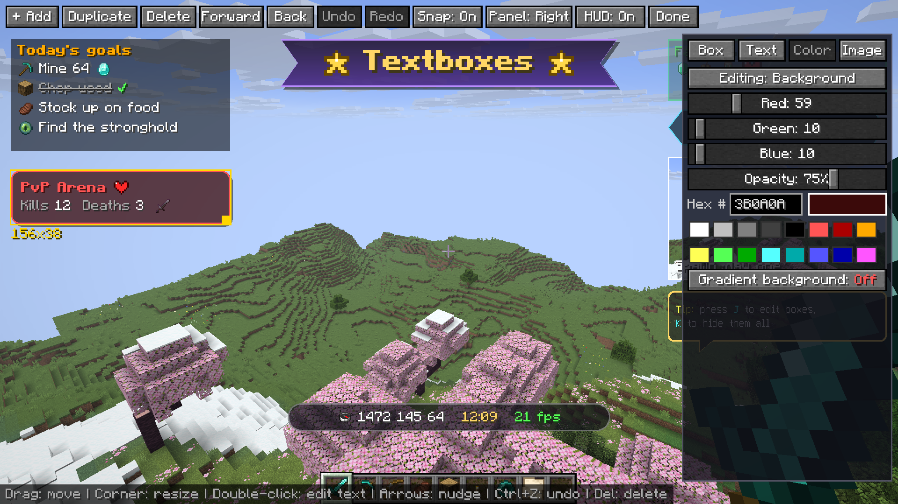
</p>

### 🔷 Box shapes
- Pick from **Rectangle**, **Rounded**, **Pill**, **Ellipse**, **Hexagon**, **Cut corners**, **Ribbon**, **Arrow** and **Speech bubble**.
- Adjust corner radius, point depth or tail size with a slider, and move a speech bubble's tail along the edge.
- Add a **gradient** background and a **drop shadow** to any shape.

<p align="center">
  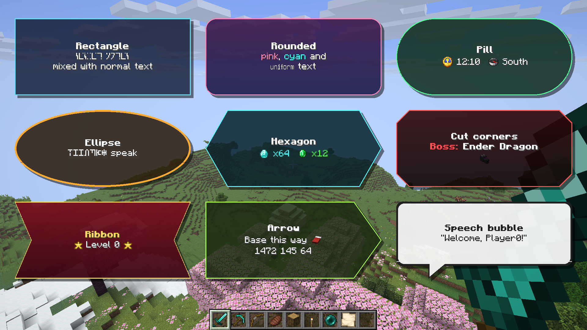
  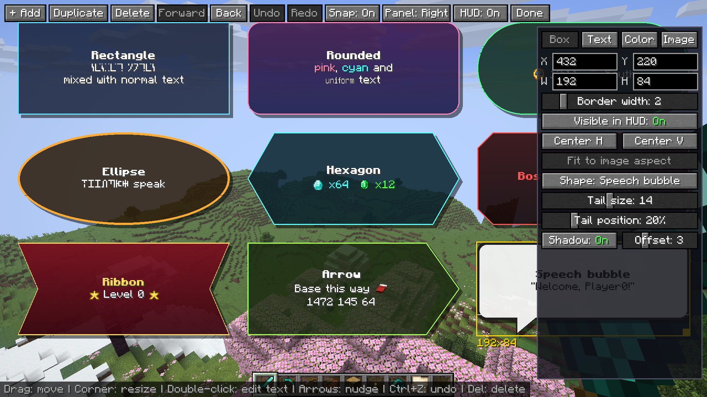
</p>

### 🎨 Colors and opacity
- Set the **background**, **text**, **border** and **image tint** separately.
- Pick colors with RGB sliders, a hex code or one-click swatches.
- Give each part its own opacity, from solid to almost invisible.

### 🔤 Fonts and text style
- **Default**, **Uniform**, **Galactic** (enchanting table), **Illageralt**, or any custom font from a resource pack.
- Bold, italic, underline, strikethrough and shadow.
- Scale, left/center/right and top/middle/bottom alignment, padding and line spacing.
- **Mix fonts and colors in one box**: `{font:galactic}` switches font partway through a line, and `{#FF8800}` switches color. The **+ Font** and **+ Color** buttons insert these for you.

<p align="center">
  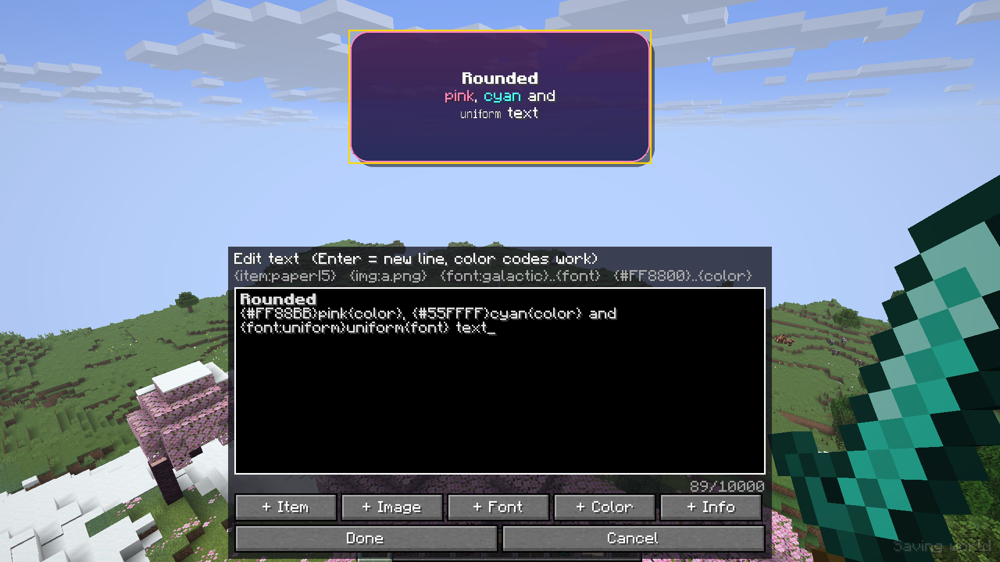
  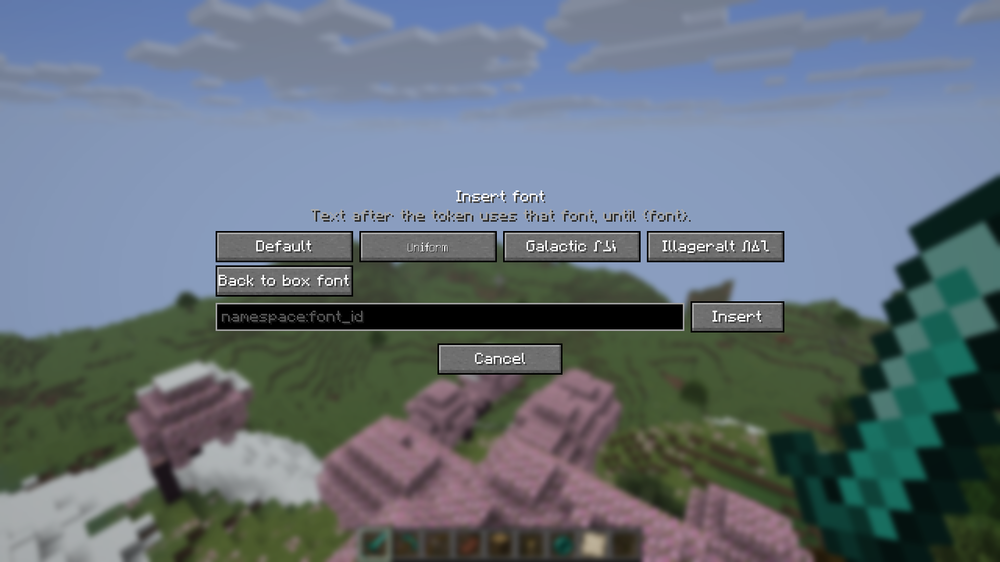
</p>

### 📡 Live info
- Show things that update by themselves: FPS, coordinates, facing, biome, time, day, health, ping and more.
- Click **+ Info** in the text editor to pick one, or type it, like `{fps}` or `{coords}`.

<p align="center">
  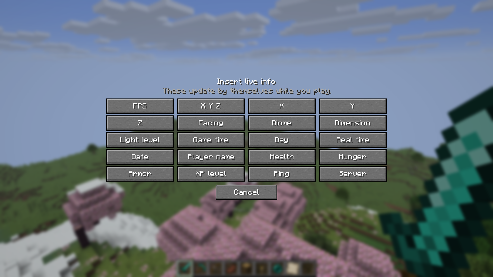
</p>

### 🖼️ Images
- Use your own PNG, JPG, GIF or BMP images as a box background.
- Drop the files in `config/textboxes/images/` and pick them from a thumbnail list.
- Stretch, fit or fill the box, or resize the box to the image's shape with one click.

<p align="center">
  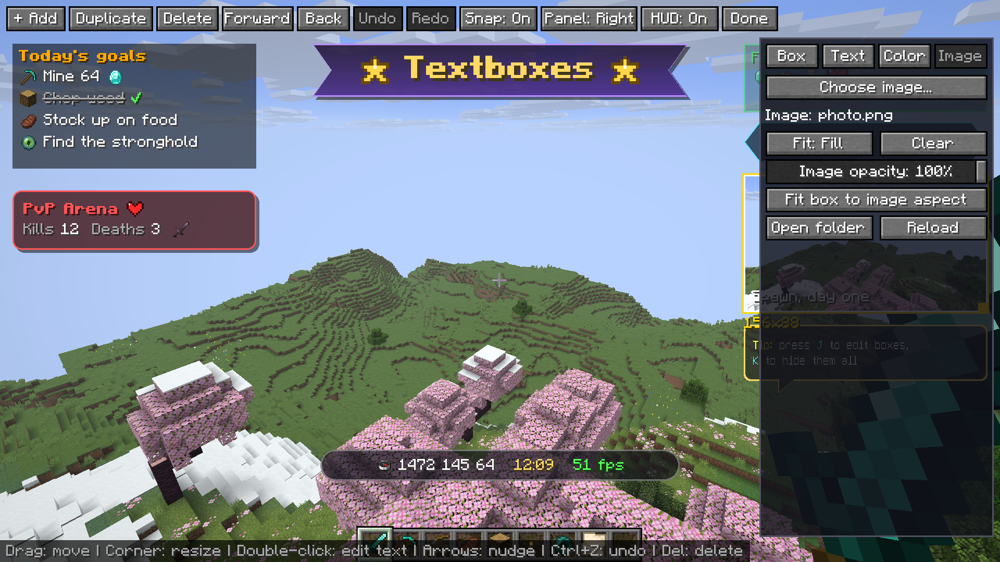
  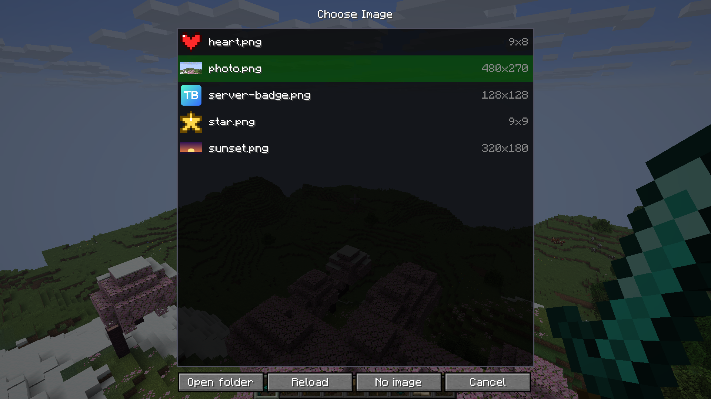
</p>

### 💎 Items and images inside the text
- Click **+ Item** to insert any item in the game, including items from other mods. The picker has search.
- Click **+ Image** to put a picture right in a line of text.
- Icons line up with the text, and you can set how big they are.
- Icons fade along with the text when you lower its opacity.

<p align="center">
  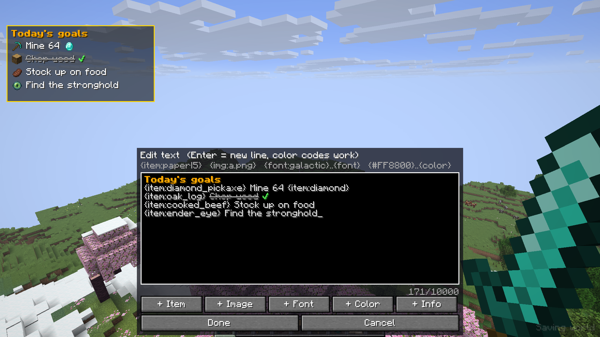
  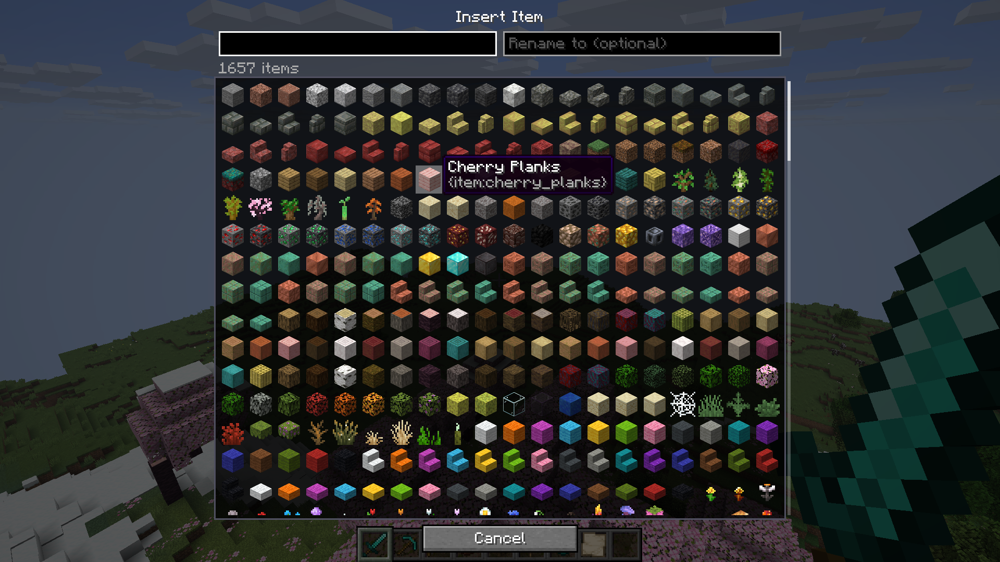
</p>

### 📦 Works with resource packs
Rename an item while inserting it (for example, paper named `5`). It shows up just like an item renamed in an anvil, so **resource packs that change textures by item name work in your textboxes too**. This is great for custom icons, number tiles or server-specific items.

<p align="center">
  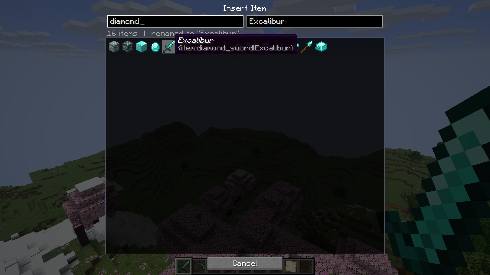
</p>

## ⌨️ Controls

| Key | Action |
|---|---|
| **J** | Open the editor |
| **K** | Show or hide all textboxes |

You can change both keys in **Options → Controls**. Inside the editor:

| Input | Action |
|---|---|
| Drag a box | Move it |
| Drag its corner | Resize it |
| Double-click or Enter | Edit its text |
| Arrow keys (+ Shift) | Nudge it by 1px (or 10px) |
| Delete | Remove it |
| Ctrl + D | Duplicate it |
| Ctrl + Z | Undo |
| Ctrl + Y | Redo |

## 🧩 Text tokens

You can also type these straight into the text editor:

| Token | Shows |
|---|---|
| `{item:diamond}` | A diamond icon |
| `{item:modid:some_item}` | An item from another mod |
| `{item:paper\|5}` | Paper renamed to "5" (resource-pack textures apply) |
| `{img:logo.png}` | An image from `config/textboxes/images/` |
| `{font:galactic}` … `{font}` | Text in another font, then back to the box's font |
| `{#FF8800}` … `{color}` | Text in another color, then back to the box's color |
| `{fps}`, `{coords}`, `{biome}`, … | Live info (click **+ Info** for the full list) |

If a token is mistyped, it shows in **red** so you can spot it and fix it.

## 📥 Installing

1. Install [Fabric Loader](https://fabricmc.net/use/) for your Minecraft version:
   - Minecraft **1.21.11**: Loader 0.18.1 or newer, and the `textboxes-1.1.0.jar` file.
   - Minecraft **26.3**: Loader 0.20.1 or newer, and the `textboxes-1.1.0+26.3.jar` file.
2. Put [Fabric API](https://modrinth.com/mod/fabric-api) and the matching Textboxes jar in your `mods` folder.
3. Start the game and press **J**.

Textboxes is client-side only, so it works on any server and the server doesn't need it installed. Your boxes are saved in `config/textboxes.json`.

## 🛠️ Building from source

This branch builds the Minecraft 26.3 version and needs Java 25. The Minecraft 1.21.11 version is on the `main` branch and needs Java 21. Then run:

```bash
./gradlew build
```

The mod jar ends up in `build/libs/`.

The store screenshots in [`screenshots/`](screenshots) are made by an automated run in `src/gametest`. It starts the game, builds a showcase world and saves fresh PNGs. That code isn't part of the mod jar. To retake the screenshots:

```bash
./gradlew runClientGameTest
```

## 📄 License

[MIT](LICENSE). See [CHANGELOG.md](CHANGELOG.md) for release notes.
